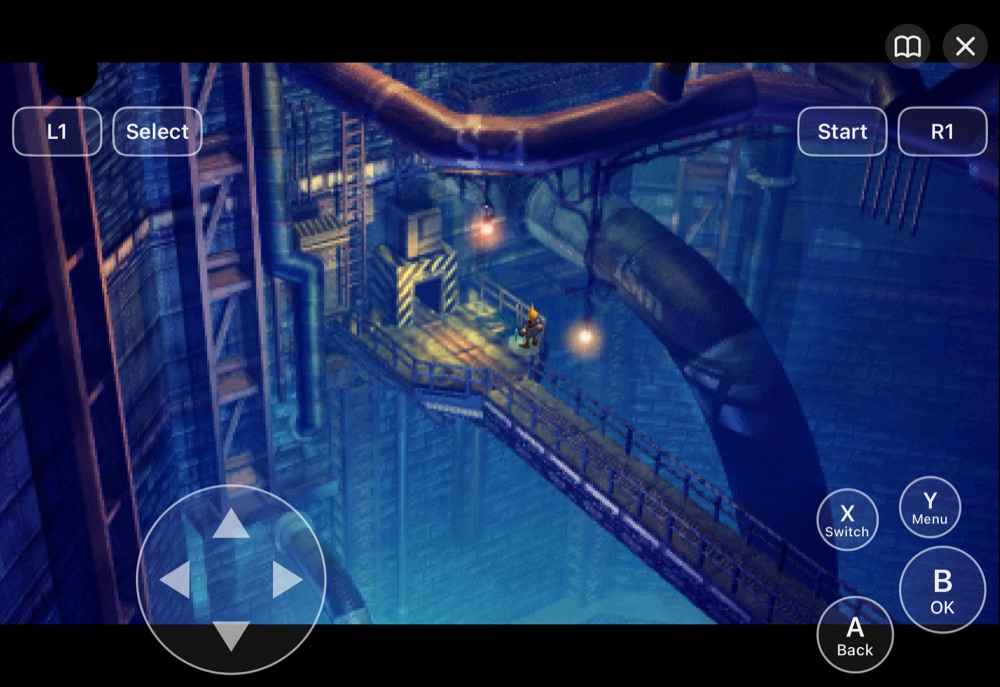
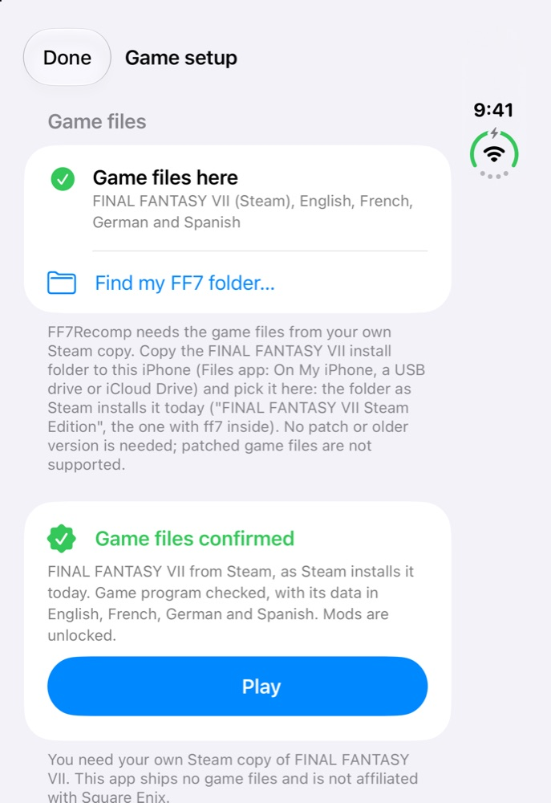

# FF7Recomp for iOS

**FINAL FANTASY VII on iPhone, natively.** An iOS port of
[FF7Recomp](https://github.com/bhuiyah/ff7-recomp-android): the Steam PC game statically
recompiled to ARM64 and drawn by [FFNx](https://github.com/julianxhokaxhiu/FFNx) on Metal, with
touch controls, game controller support, an iPhone Duo layout with a status panel, and a launcher
for your saves and mods.

**No game is included.** You build it from your own Steam copy of FINAL FANTASY VII with
**FF7Recomp Builder**, a small Mac app ([download](https://github.com/eepykith/ff7-recomp-ios/releases)).
iOS can't compile code on the phone, so the Mac does it once and makes an app to install.

> Pre-release ([v0.2.2](https://github.com/eepykith/ff7-recomp-ios/releases/tag/v0.2.2)): tested
> through the first reactor and its boss on an iPhone Duo, now with mods from 7th Heaven's
> catalogs. Expect rough edges.

## Screenshots

Running in the iOS simulator from a build made by FF7Recomp Builder. The game is the player's own
Steam copy, played by touch.

<table>
<tr>
<td width="40%"></td>
<td>

**iPhone Duo, open or half-folded and upright.** While the hinge is open or half open the game
goes upright: the picture in the top half, clear of the fold, and below it the Android port's
bottom-screen panel. It shows where the party is, play time, gil, each member's HP, MP and Limit
(ATB and enemy HP in battle), and touch buttons: Menu, save and load state, speed 1×/2×/3×,
random battles on/off and Battle+. The pad keeps to the side columns, so a thumb on it never lands
on the panel. With a game controller connected the pad goes away in every layout (Settings >
Controls: hide with a controller, always show, never show).

</td>
</tr>
</table>

| iPhone Duo open, landscape | iPhone Duo closed (outer screen) |
|---|---|
|  |  |
| The picture fills the screen and the pad lies over its edges. | The outer screen switches to landscape; the pad stays clear of the camera. |

| iPhone (iPhone 18 Pro) |
|---|
|  |
| On a regular iPhone the game plays in landscape, with the pad in the black bars beside the 4:3 picture. Slide a thumb across the d-pad (8 directions) or the face buttons without lifting; any number of fingers at once; every tap reaches the game, however fast. |

| First launch | FF7Recomp Builder (Mac) |
|---|---|
|  |  |
| The app confirms the game files (the 1.02 US exe and its data), and Play starts the game. Mods unlock once the files are confirmed. | Finds your Steam copy, checks it, and builds FF7Recomp.ipa with the game and your game files in it (see [Get started](#get-started)). |

## Get started

You need:

- A Mac with **Apple silicon** and **Xcode** (from the App Store, opened once).
- **FINAL FANTASY VII from Steam**, as Steam installs it today (`FINAL FANTASY VII Steam Edition`,
  the one with `ff7` inside). No patch or older version is needed; patched game files are not
  supported.
- A way to sign and install an IPA on your iPhone: a development profile, AltStore, SideStore or
  similar.

Then:

1. Download **FF7Recomp Builder** from [Releases](https://github.com/eepykith/ff7-recomp-ios/releases),
   unzip it and open it. It isn't notarized: the first time, right-click it → **Open** (or System
   Settings → Privacy & Security → **Open Anyway**).
2. It finds your Steam copy (or choose the folder), checks it is the 1.02 US build, and checks
   Xcode is there. **Build FF7Recomp.ipa…** lifts the game to C, compiles it for iPhone, links it
   with the engine and adds your game files. The first build takes a few minutes; the IPA is about
   3 GB.
3. Sign the IPA and install it. Keep the **extended virtual addressing** entitlement if your
   profile has it: the game reserves 4 GB of address space.
4. Open FF7Recomp. It confirms your game files, and **Play** starts the game.

**The IPA holds the game built from your copy and your game files: it is for your own devices
only. Never share it.** The builder itself holds no game code and no game files.

### Your files

In the Files app under **On My iPhone › FF7Recomp**, to back up, move to another device or add to
by hand:

| Folder | What |
|---|---|
| `Saves` | the game's saves (`save00.ff7` …) |
| `Save States` | save states (the status panel's Save/Load, or Select + L1 / Select + R1) |
| `Mods` | 7th Heaven mods (`.iro` archives and folders) and their order (`profile.xml`) |

### Controls

- **Touch pad:** slide a thumb across the d-pad (8 directions) or the face buttons without lifting;
  any number of fingers at once. The buttons are labelled as the game's own prompts: **B** (right)
  is OK, **A** (bottom) is cancel and run, **Y** opens the menu.
- **Game controllers** over Bluetooth. The touch pad hides while one is connected (Settings →
  Controls: hide with a controller, always show, never show).
- **✕ → Quit** closes the app (the game runs once per launch); open FF7Recomp again to play.

### iPhone Duo

Open or half-folded and held upright, the game sits in the top half, clear of the fold, and the
bottom half is a status panel (party HP/MP/Limit, location, play time, gil; ATB and enemy HP in
battle) with quick buttons: Menu, save and load state, speed 1×/2×/3×, random battles on/off and
Battle+. Turn it sideways or close it and the game fills the screen.

## What works

- The game from the intro through the first reactor and its boss, played on an iPhone Duo:
  field, battles, menus, movies, music and sound, saves and save states.
- Touch controls, Bluetooth controllers, the iPhone Duo's folded, half-folded and open screens.
- Your saves, save states and mods in the Files app.
- **Get Mods:** browse 7th Heaven's Qhimm and Sega catalogs in the app, download and update mods
  (`.iro`, `.zip`, `.7z`, Google Drive links included) one after another while you browse, with
  conflict warnings before and after. Mods load in the game in the order set in the Mods list;
  touch and hold a mod for its options or to delete it.
- **Frame rate** (Settings): the game's own rates, 30 FPS battles, 60 FPS, or 120 FPS in the
  field on 120 Hz screens such as the iPhone Duo's.
- Leaving the app or taking a call pauses the game and its sound; it goes on where it was. The
  silent switch mutes the game.

Known gaps:

- **Mods** are tested in the simulator (a folder mod, a .7z mod from the catalog). `.iro`
  archives and large texture packs still need testing on an iPhone; mods on Mega or forum pages
  open in Safari to download by hand, and RAR archives aren't supported.
- Tested on an iPhone Duo and in the simulator; other iPhones and iPads are untested.
- FF7Recomp Builder runs on Apple silicon Macs only, and isn't notarized.

## Roadmap

What comes next, roughly in order:

1. **Mods on the iPhone.** Download and play `.iro` mods and large texture packs on a device
   (memory, storage, load times).
2. **A longer playthrough.** Play on past the first reactor through Midgar, fixing what breaks;
   test more iPhones and iPads.
3. **Builder for everyone.** Sign and notarize FF7Recomp Builder so macOS opens it without a
   warning, and support Intel Macs.
4. **Toward 1.0.** Settings for the picture (widescreen, filters), Steam Cloud saves, and in-app
   help for signing and installing.

## How it works

- **Static recompilation.** The lifter turns the game's 32-bit x86 code (`ff7_en.exe`) into C,
  compiled for ARM64; Win32 is replaced by a small layer of its own, and the game's 32-bit memory
  lives in a 4 GB-aligned window (iOS can't map anything below 4 GB).
- **Rendering and sound.** [FFNx](https://github.com/julianxhokaxhiu/FFNx) draws through bgfx on
  Metal, plays movies with FFmpeg and music with SoLoud; sound effects go out through CoreAudio.
- **The core** comes from the Android port, fetched pinned and patched for Apple by the scripts
  in `tools/` and `patches/`. Building from source: [`docs/BUILDING.md`](docs/BUILDING.md).

## Legal

FF7Recomp for iOS is GPL-3.0 ([`LICENSE`](LICENSE)), like FFNx and the Android port it comes from.

You need your own Steam copy of FINAL FANTASY VII. Builds that include the game are for your own
devices only and must not be distributed. Not affiliated with or endorsed by Square Enix.
FINAL FANTASY is a trademark of Square Enix. Sideload only, not the App Store.
