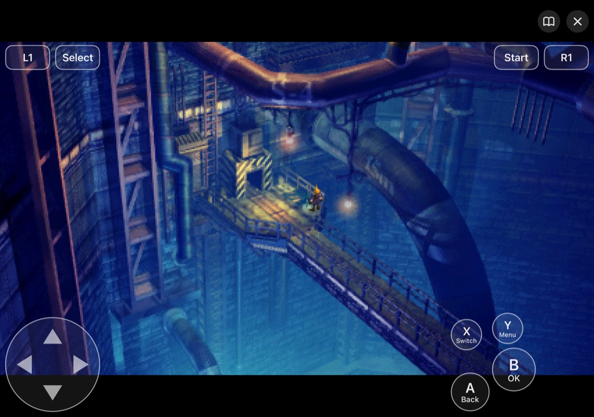
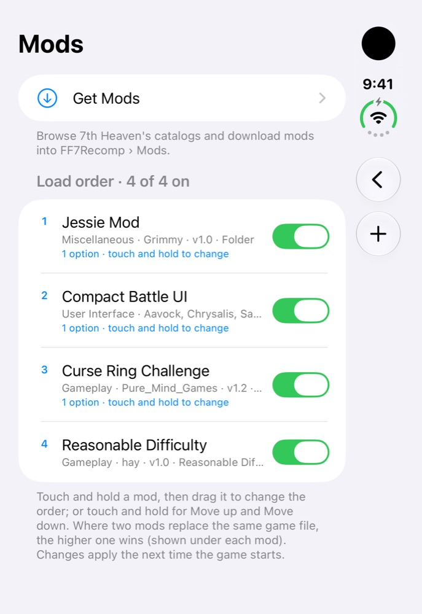
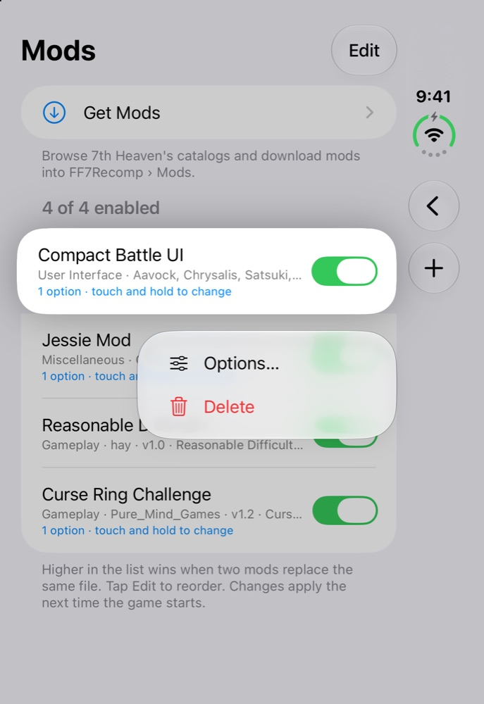
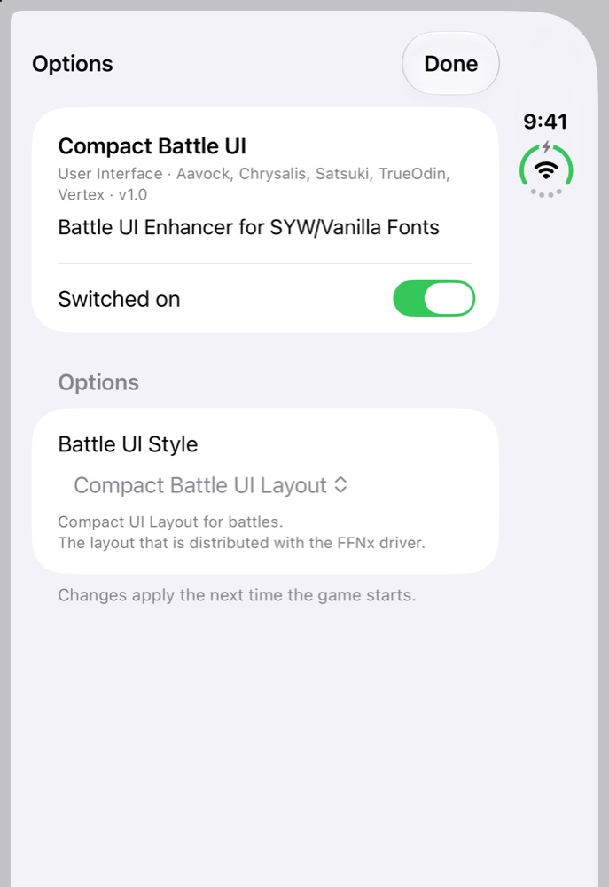
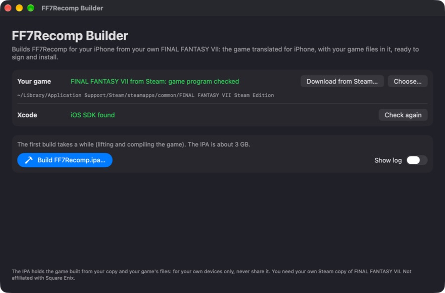

  

# FF7Recomp for iOS

[-111111)](https://github.com/eepykith/ff7-recomp-ios/releases)

**FINAL FANTASY VII on iPhone — native ARM64, Metal, your Steam copy.**

An iOS port of [FF7Recomp](https://github.com/bhuiyah/ff7-recomp-android): the Steam PC game is
statically recompiled to ARM64 and drawn by [FFNx](https://github.com/julianxhokaxhiu/FFNx) on
Metal. Touch controls, Bluetooth controllers, an iPhone Duo layout with a status panel, and a
launcher for saves and mods.

> [!IMPORTANT]
> **No game is included.** You build an IPA from **your own Steam copy** of FINAL FANTASY VII with
> **FF7Recomp Builder** ([download](https://github.com/eepykith/ff7-recomp-ios/releases)). The Mac
> lifts and packs the game once; iOS cannot compile on-device.

> [!NOTE]
> **Pre-release** ([v0.2.3b](https://github.com/eepykith/ff7-recomp-ios/releases/tag/v0.2.3b)) on
> an **iPhone Duo**: tested through the first reactor; full game expected playable. Includes mods
> from 7th Heaven catalogs. Still a pre-release — expect rough edges. Sideload only — not the App
> Store.

---

## Contents

- [Screenshots](#screenshots)
- [Requirements](#requirements)
- [Get started](#get-started)
- [Install on iPhone (sideloading)](#install-on-iphone-sideloading)
- [On your iPhone](#on-your-iphone)
- [What works](#what-works)
- [Mods](#mods)
- [Known gaps](#known-gaps)
- [Roadmap](#roadmap)
- [How it works](#how-it-works)
- [Credits](#credits)
- [Legal](#legal)

---

## Screenshots

Built with FF7Recomp Builder from the player's own Steam copy; played by touch in the simulator
and on device.

<table>
<tr>
<td width="40%"></td>
<td>

### iPhone Duo — upright

Open or half-folded and held upright: the game sits in the **top half**, clear of the fold. Below
it, a companion status panel shows location, play time, gil, and each member's HP, MP, and Limit
(ATB and enemy HP in battle), plus quick buttons — Menu, save/load state, speed 1×/2×/3×, random
battles, Battle+.

The touch pad stays in the side columns so thumbs never land on the panel. With a controller
connected, the pad hides (Settings → Controls).

</td>
</tr>
</table>

| iPhone Duo open, landscape | iPhone Duo closed (outer screen) |
| :---: | :---: |
|  |  |
| Picture fills the screen; pad over the edges. | Outer screen goes landscape; pad clear of the camera. |

| Regular iPhone (landscape) |
| :---: |
|  |
| Pad in the black bars beside the 4:3 picture. Slide without lifting; multi-touch; every tap reaches the game. |

| Mods | Get Mods | A catalog mod |
| :---: | :---: | :---: |
|  |  |  |
| Your mods in load order; higher wins. Switch each on or off. | 7th Heaven's Qhimm and Sega catalogs: search, categories, updates. | Preview and details; **Install** downloads it in the background. |

| Touch and hold a mod | Mod options |
| :---: | :---: |
|  |  |
| **Options…** or **Delete**. | The mod's own settings, applied the next time the game starts. |

| First launch | FF7Recomp Builder (Mac) |
| :---: | :---: |
|  |  |
| Confirms your Steam game files, then **Play**. Mods unlock after confirm. | Finds Steam, checks the copy, builds **FF7Recomp.ipa**. |

---

## Requirements

| You need | Details |
| --- | --- |
| **Mac (Apple silicon)** | Builder runs on Apple silicon only (not Intel). |
| **Xcode** | From the Mac App Store; open it once after install. |
| **FINAL FANTASY VII on Steam** | Current Steam Edition (`ff7` layout). No older patch; patched installs are not supported. |
| **Sideloading** | Development profile, [AltStore](https://altstore.io/), [SideStore](https://sidestore.io/), or similar. |

---

## Get started

### 1. Download the Builder

Grab **FF7Recomp Builder** from
[Releases](https://github.com/eepykith/ff7-recomp-ios/releases), unzip it, and open it.

> [!TIP]
> The Builder is **not notarized** yet. First launch: right-click → **Open**, or System Settings →
> Privacy & Security → **Open Anyway**.

### 2. Build your IPA

1. The Builder finds your Steam copy (or let you pick the folder).
2. It checks the game is as Steam installs it today (no patches) and that Xcode is present.
3. Click **Build FF7Recomp.ipa…** — it lifts the game to C, compiles for iPhone, links the
   engine, and packs your game files.

The first build takes a few minutes. The IPA is about **3 GB**.

### 3. Sign and install

Sideload the IPA onto your iPhone (not the App Store). See
[Install on iPhone (sideloading)](#install-on-iphone-sideloading) for SideStore, AltStore,
Sideloadly, and similar tools.

### 4. Play

Open **FF7Recomp** → confirm game files → **Play**.

> [!CAUTION]
> The IPA contains the game built from **your** copy and **your** game files. It is for **your
> own devices only. Never share it.** The Builder itself ships no game code and no game files.

Building the project from source (contributors / developers): see
[`docs/BUILDING.md`](docs/BUILDING.md).

---

## Install on iPhone (sideloading)

FF7Recomp is **sideload only** — it is not on the App Store. You install the **IPA you built**
from your own Steam copy with FF7Recomp Builder. Pick any resign/install tool you already trust;
the notes below are the usual paths.

> [!WARNING]
> When the tool **re-signs** the IPA, keep
> **`com.apple.developer.kernel.extended-virtual-addressing`** (extended virtual addressing).
> The game reserves a 4 GB address window; dropping that entitlement often breaks launch. If the
> UI has an entitlements list or “keep entitlements” option, leave it on / do not strip it.

> [!CAUTION]
> The IPA is for **your devices only**. Do not upload it to public IPA libraries or share it.

### SideStore

1. Install [SideStore](https://sidestore.io/) on your iPhone (follow their current pairing /
   refresh setup).
2. Copy your `FF7Recomp.ipa` to the phone (Files, AirDrop, cloud folder, etc.).
3. In SideStore → **My Apps** (or equivalent) → install from that IPA.
4. Confirm extended virtual addressing stayed on the signed app if SideStore shows entitlements.
5. Refresh / keep SideStore’s signing alive as their docs describe (free Apple IDs expire on a
   short cycle).

### AltStore

1. Run [AltServer](https://altstore.io/) on your computer and install **AltStore** on the iPhone.
2. Put `FF7Recomp.ipa` in Files on the device (or open it from AltStore’s import flow).
3. In AltStore, install the IPA.
4. Keep extended virtual addressing when AltStore resigns; refresh via AltServer as needed.

### Sideloadly

1. On a Mac or Windows PC, open [Sideloadly](https://sideloadly.io/), connect the iPhone, and
   sign in with your Apple ID when asked.
2. Drop in `FF7Recomp.ipa`.
3. Before installing: if there is an entitlements / “live container” / advanced options panel,
   **keep** extended virtual addressing — do not use a mode that strips custom entitlements.
4. Start the install and wait for the app to appear on the Home Screen. Trust the developer in
   Settings → General → VPN & Device Management if iOS asks.

### Other options

| Tool | High-level |
| --- | --- |
| **Xcode** (free or paid Apple Developer) | Open/import the signed app or use a development profile you control; install to a paired device. Same entitlement rule. |
| **Other resign utilities** | Same idea: sign the Builder IPA for your team/Apple ID and install over USB or Wi‑Fi. Prefer tools that preserve existing entitlements. |

Free personal Apple IDs used with SideStore / AltStore / Sideloadly typically need periodic
**refresh** or reinstall when the short signing window ends. A paid Apple Developer account lasts
longer. Exact UI labels change — when in doubt, check that tool’s docs and the entitlement
warning above.

---

## On your iPhone

### Files

In the **Files** app → **On My iPhone › FF7Recomp**:

| Folder | Contents |
| --- | --- |
| `Saves` | Game saves (`save00.ff7` …) |
| `Save States` | Save states (status panel Save/Load, or Select+L1 / Select+R1) |
| `Mods` | 7th Heaven mods (`.iro` / folders) and load order (`profile.xml`) |

Use these folders to back up, move between devices, or add files by hand.

### Controls

| Input | Notes |
| --- | --- |
| **Touch pad** | Slide across the d-pad (8-way) or face buttons without lifting; multi-touch. Labels match the game: **B** (right) = OK, **A** (bottom) = cancel / run, **Y** = menu. |
| **Bluetooth controller** | Supported. Pad hide modes: Settings → Controls (hide with controller / always / never). |
| **Quit** | ✕ → Quit exits the app (one game session per launch). Reopen FF7Recomp to play again. |

### iPhone Duo

| Pose | Layout |
| --- | --- |
| Open / half-folded, upright | Game in top half; status panel + pad below |
| Landscape or closed | Game fills the active screen |

---

## What works

On an **iPhone Duo**: tested through the first reactor; full game expected playable.

- Field, battles, menus, **movies**, music & SFX
- Saves and save states
- Touch pad and Bluetooth controllers
- Duo folded / half-folded / open layouts
- Files-app folders for saves, states, and mods
- **Get Mods** — Qhimm & Sega catalogs; download `.iro` / `.zip` / `.7z` (incl. Google Drive);
  conflict warnings; touch-and-hold for options / delete
- **Frame rate** (Settings): original / fixed / 30 FPS battles / 60 / experimental **120** on
  120 Hz screens
- Background / calls pause the game; silent switch mutes

---

## Mods

Browse **Get Mods** in the app, or drop archives into the `Mods` folder. Load order follows
`profile.xml` in the Mods list.

### Tested together (iPhone Duo, 0.2.x)

Eight mods enabled at once (~63k replaced files), with save states in a short playthrough:

| Mod | Category | Status | Notes |
| --- | --- | --- | --- |
| [Tsunamods] Echo-S 7 | Gameplay | ✅ | 3.2 GB; code patches apply |
| [Tsunamods] Enhanced Stock UI | UI | ✅ | |
| [Tsunamods] Cosmo Memory | Media | ✅ | |
| [Tsunamods] SYW Unified Field Textures | Field | ✅ | Black backgrounds after save-state load fixed in 0.2.3 |
| [Tsunamods] SYW Unified Battle Textures | Battle | ✅ | |
| [Tsunamods] SYW Unified Spell Textures | Spell | ✅ | |
| NinoStyle HD Field Models | Field Models | ✅ | |
| NinoStyle Battle Models | Battle Models | ✅ | |
| Jessie Mod | Misc | ✅ | Simulator only; Options… works |

✅ no issues · ⚠️ works with issues · ❌ doesn't work

Tried a mod? [Open an issue](https://github.com/eepykith/ff7-recomp-ios/issues) with how it went.

> [!NOTE]
> With this stack, FFNx.log may mention a missing field piece (`AUGC1.RSD`). Nothing wrong on
> screen so far. **Not in-app yet:** Mega / forum downloads (use Safari + **Import Mods**), and
> **RAR** archives.

---

## Known gaps

| Area | Status |
| --- | --- |
| Non-Duo iPhone / iPad | Untested (simulator + Duo only) |
| Builder notarization | Open — Gatekeeper “Open Anyway” on first launch |
| Intel Mac Builder | Not supported |
| Mega / forum / RAR mod downloads | Manual Safari + Import; RAR refused |
| Quit | Exits the app (by design for now) |

---

## Roadmap

Planned by version. Order may change as reports come in.

### 0.2.4 — Reports from players, easier mod order
|Item|Plan|
|---|---|
|**Share logs**|Packs logs, device, and mod list for a GitHub issue; offered after a crash|
|**Report a problem**|Opens a GitHub issue with version and device filled in|
|**Easier mod order**|Drag to re-order (no Edit mode); shows which mod wins on file conflicts|

### 0.3 — Easier setup, widescreen, and a new touch pad
|Item|Plan|
|---|---|
|**Steam download in Builder**|Sign in with your Steam account; builder downloads the game (no Mac Steam app)|
|**Intel Mac support**|Builder on Intel Macs|
|**Widescreen (16:9)**|Fills the screen instead of 4:3 side bars; Duo + iPhone 18 Pro (simulator)|
|**New touch pad**|See-through outlines; round d-pad; big **OK** (B) / **Back** (A); **Menu** (Y) / **Switch** (X) above|
|**Buttons shown**|Settings: pick d-pad, OK, Back, Menu, Switch, L1, R1, Start, Select (or Show all)|
|**Size and layout**|Settings editor to resize and move pad parts|
|**iPhone Duo upright**|D-pad and face buttons higher (thumb rest on lower half), not at the bottom|
|**Code clean-up**|Neutral names for the shared engine (no Android paths or settings in our code); comments describe our own code|

### 0.4 — A polished launcher
|Item|Plan|
|---|---|
|**Aesthetics**|Home screen art; smoother Get Mods / Mods; clearer first launch|
|**More devices**|Regular iPhones and iPads beyond the Duo|
|**Game Center achievements**|The game's 32 achievements; system pop-ups and Game Center profile|

### 0.5 — Mac app, iCloud sync, MetalFX, and haptics
|Item|Plan|
|---|---|
|**Mac game app**|Same builder, from your Steam copy|
|**iCloud sync**|Saves, save states, and mods across Mac, iPhone, and iPad|
|**MetalFX upscaling**|Lower-res draw + Metal upscale; less heat / longer battery (or sharper), esp. HD textures|
|**Controller haptics**|Xbox / DualSense rumble; DualSense adaptive triggers; Taptic Engine on the touch pad|

### Toward 1.0
|Item|Plan|
|---|---|
|**HDR (EDR)**|Brighter magic / Mako highlights on supported iPhone and iPad screens|
|**External display**|Game on TV/monitor over USB-C; iPhone as controller and status panel|
|**Also**|Display settings (filters), Steam Cloud saves, in-app install help|

---

## How it works

- **Static recompilation** — `ff7_en.exe` (32-bit x86) is lifted to C and compiled for ARM64.
  Win32 is replaced by a thin host layer; guest memory lives in a 4 GB–aligned window.
- **Rendering & audio** — [FFNx](https://github.com/julianxhokaxhiu/FFNx) via bgfx → **Metal**;
  movies with FFmpeg; music with SoLoud; SFX through CoreAudio.
- **Core** — from the Android port, fetched pinned and patched for Apple (`tools/`, `patches/`).

Contributor / from-source builds: **[`docs/BUILDING.md`](docs/BUILDING.md)**.

---

## Credits

Rendering, movies, timing fixes, and the modding surface in this port come from
**[FFNx](https://github.com/julianxhokaxhiu/FFNx)** — the next-generation FINAL FANTASY VII / VIII
modding platform (GPL-3.0). FFNx continues [FF7_OpenGL](https://github.com/Aali132/ff7_opengl) by
[Aali](http://forums.qhimm.com/index.php?topic=14922.0).

**FFNx core team** (as listed by the [FFNx project](https://github.com/julianxhokaxhiu/FFNx)):

- [Julian Xhokaxhiu](https://github.com/julianxhokaxhiu)
- [Tang-Tang Zhou](https://github.com/tangtang95)
- [Jérôme Arzel](https://github.com/myst6re)
- [CosmosXIII](https://github.com/CosmosXIII)

The static-recompilation core used here comes from
[FF7Recomp for Android](https://github.com/bhuiyah/ff7-recomp-android). Further FFNx contributors
and earlier Qhimm-era work are credited in [FFNx’s own README](https://github.com/julianxhokaxhiu/FFNx#credits).

---

## Legal

FF7Recomp for iOS is **GPL-3.0** ([`LICENSE`](LICENSE)), like FFNx and the Android port.

You need your own Steam copy of FINAL FANTASY VII. Builds that include the game are for your own
devices only and must not be distributed. Not affiliated with or endorsed by Square Enix.
FINAL FANTASY is a trademark of Square Enix. **Sideload only — not the App Store.**
